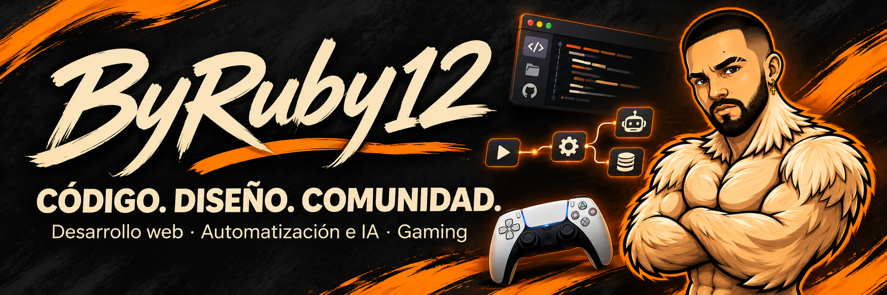
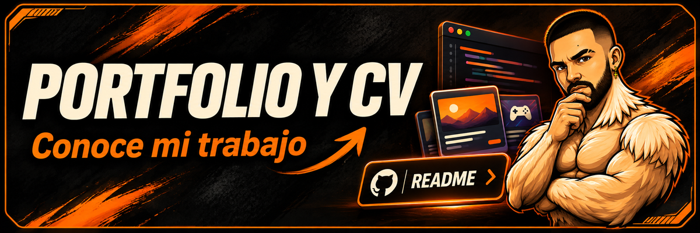
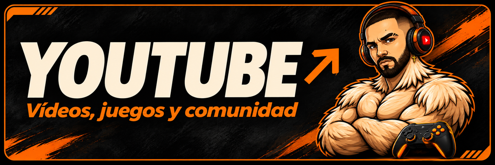
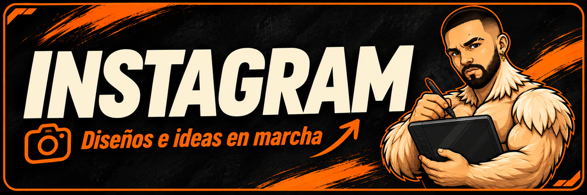
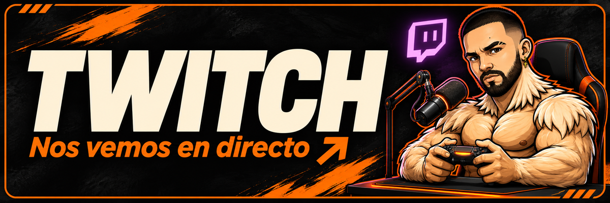
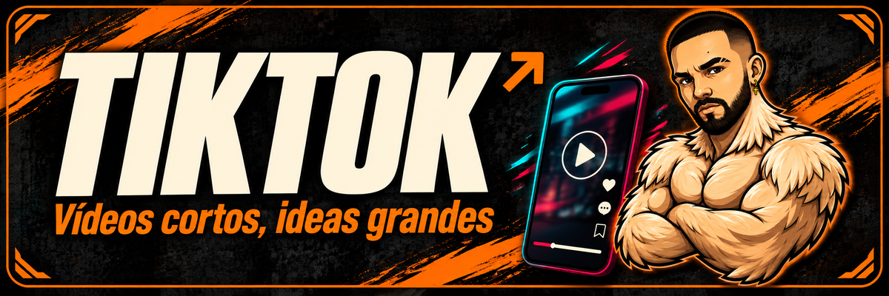
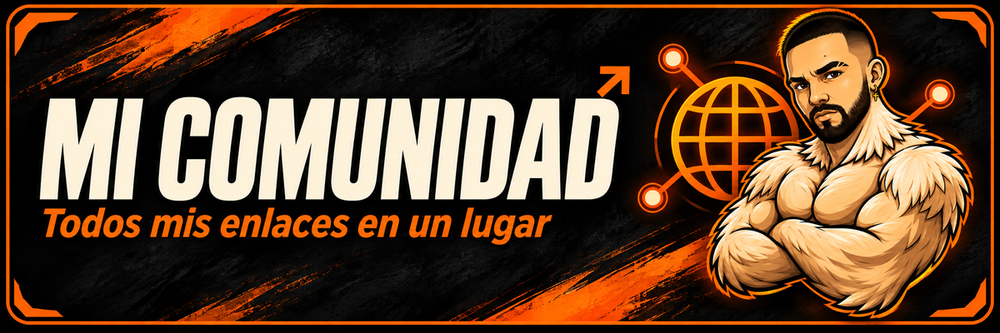
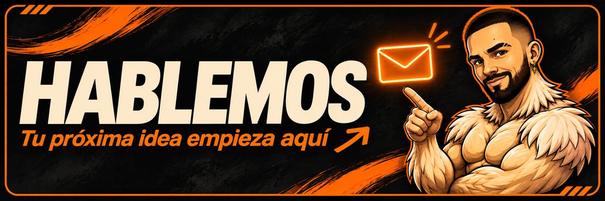

<!-- Perfil de ByRuby12. Imágenes enlazadas a los archivos existentes en main/imagenes. -->

<h1>Hola, soy Tomás Cano 👋</h1>
<h3>Desarrollo web · Automatización e IA · Diseño digital</h3>

De la idea a la interfaz. De los datos a la solución. Código, creatividad y comunidad con identidad propia.

<strong>📍 Madrid, España &nbsp; / &nbsp; 💻 ByRuby12</strong>

<a href="#proyectos-destacados">Proyectos</a> &nbsp; · &nbsp;
<a href="#tecnologias">Tecnologías</a> &nbsp; · &nbsp;
<a href="#servicios-digitales">Servicios</a> &nbsp; · &nbsp;
<a href="#comunidad">Comunidad</a> &nbsp; · &nbsp;
<a href="#contacto">Contacto</a>

<a href="https://github.com/ByRuby12/Portfolio-Tomas/raw/refs/heads/main/docs/CV%20TOMAS%2020262027%20NEW.pdf"><strong>Descargar mi CV ↗</strong></a> &nbsp; · &nbsp; <a href="https://www.linkedin.com/in/canoo18/">LinkedIn ↗</a>

---

## ✦ De una idea a algo que funciona

Soy **Tomás Cano Nieto**, desarrollador web con formación en **Desarrollo de Aplicaciones Web** y **Sistemas Microinformáticos y Redes**. Combino programación, diseño y conocimiento de la operativa de un negocio: desde una interfaz responsive hasta el panel de gestión, los datos y las tareas del día a día.

He trabajado con comercio electrónico, CRM, inventario, ticketing, bots, APIs, automatizaciones y herramientas de Inteligencia Artificial. Me interesa entender el problema, construir una solución clara y cuidar tanto su funcionamiento como su presentación.

Mi otra gran parte es **ByRuby12**: más de nueve años creando contenido, compartiendo videojuegos y desarrollando ideas para una comunidad online.

<table>
<tr>
<td width="50%" align="center"></td>
<td width="50%" align="center"></td>
</tr>
</table>

---

## ⚡ Qué puedo construir

| Área | Aplicaciones |
| :--- | :--- |
| **Web y e-commerce** | Webs responsive, tiendas online, cartas digitales con QR, páginas corporativas y paneles de administración. |
| **Gestión y datos** | CRM, inventario, stock, ticketing, bases de datos e integraciones entre herramientas. |
| **Automatización e IA** | Bots de Telegram y Discord, clasificación de solicitudes, conexión con APIs y automatización de procesos. |
| **Diseño y contenido** | Identidad para creadores, banners, miniaturas, cartelería, retoque fotográfico y edición de vídeo. |
| **Sistemas y soporte** | Configuración de equipos, redes, mantenimiento y resolución de incidencias. |

---

## 🚀 Proyectos destacados

Una selección de repositorios para conocer mi trabajo. Las funciones y el estado de cada proyecto se detallan en su repositorio.

| Proyecto | Qué encontrarás | Código |
| :--- | :--- | :---: |
| **Portfolio personal** | Presentación, trayectoria, proyectos y acceso al CV. | [↗](https://github.com/ByRuby12/Portfolio-Tomas) |
| **ByRuby12 · Servicios** | Catálogo de servicios de desarrollo web, diseño e identidad digital. | [↗](https://github.com/ByRuby12/ByRuby12-Servicios) |
| **La Tortillería** | Carta digital para hostelería con experiencia responsive y administración. | [↗](https://github.com/ByRuby12/LaTortilleria) |
| **Bohio Bar** | Proyecto de carta web para un negocio de hostelería. | [↗](https://github.com/ByRuby12/BohioBar) |
| **CartaWebVersiones** | Versiones y recursos para cartas digitales. | [↗](https://github.com/ByRuby12/CartaWebVersiones) |
| **AyuntMadrid** | Bot de Telegram con IA para avisos y peticiones ciudadanas. | [↗](https://github.com/ByRuby12/AyuntMadrid) |
| **StockageTienda** | Herramienta web para organizar inventario y operaciones de tienda. | [↗](https://github.com/ByRuby12/StockageTienda) |
| **LeidersRP** | Plataforma y herramientas para una comunidad de GTA V Roleplay en PS4 y PS5. | [↗](https://github.com/ByRuby12/LeidersRP) |

<strong>También hay aprendizaje, juegos y experimentos</strong>

- [TFG DAW · Deportistas del Barrio](https://github.com/ByRuby12/TFG-DAW): proyecto de fin de ciclo de Desarrollo de Aplicaciones Web.
- [Bibliotech DAW](https://github.com/ByRuby12/Bibliotech-DAW): proyecto académico desarrollado en Java.
- [WebUniversal](https://github.com/ByRuby12/WebUniversal): proyecto web para negocios.
- [TPV Hostelería](https://github.com/ByRuby12/TPV-Hosteleria): proyecto relacionado con la gestión de hostelería.
- [CremEsports](https://github.com/ByRuby12/CremEsports): mi primera página web.
- [Videojuegos HTML](https://github.com/ByRuby12/Videojuegos-HTML) y [Processing](https://github.com/ByRuby12/VideoJuegos-Processing): minijuegos y experimentos.
- [PolloLoco](https://github.com/ByRuby12/PolloLoco): proyecto de juego web.
- [Más repositorios](https://github.com/ByRuby12?tab=repositories): el resto de mi recorrido.

---

## 🛠️ Tecnologías y herramientas

Tecnologías con las que he trabajado en proyectos profesionales, personales o de formación.

| Frontend | Backend y datos | Integraciones y diseño |
| :--- | :--- | :--- |
| HTML5 · CSS3 · JavaScript | PHP · Python · Java | APIs REST · OpenAI API |
| Vue · Tailwind CSS · Bootstrap | NestJS · SQL · MariaDB | Telegram · Discord |
| Diseño responsive | Firebase · Firestore | Photoshop · Edición de vídeo |

## 🧩 Experiencia que suma

- **Desarrollo y operación de tiendas online:** páginas corporativas, e-commerce, CRM, catálogo, stock, inventario y logística.
- **Automatización de procesos:** bots, APIs de IA, tratamiento de datos públicos y clasificación de solicitudes.
- **Trabajo con negocios y comunidades:** herramientas para hostelería, comercio, creadores de contenido y roleplay.
- **Diseño y comunicación:** más de seis años utilizando Photoshop, además de banners, material gráfico y contenido audiovisual.
- **Base técnica:** formación en sistemas y redes, soporte a usuarios y desarrollo de aplicaciones web.

[Consulta mi trayectoria completa y formación en el portfolio →](https://byruby12.github.io/Portfolio-Tomas/)

---

## ✳️ Servicios digitales · ByRuby12

Además de mis proyectos, ofrezco servicios para negocios y creadores. En la web puedes consultar ejemplos, condiciones, alcance y precios actualizados.

| Para tu negocio | Para tu marca |
| :--- | :--- |
| Tienda online completa | Pack Creador: identidad y recursos para redes |
| Web profesional desde cero | Carteles, flyers y cartas |
| Contactos para tu negocio en Excel | Retoque y edición de fotos |
| Mantenimiento y mejoras web | Tu marca a lo grande: publicidad de gran formato |
| Universal Works | Tu local ahora en digital: web y carta QR |

**[Explorar los diez servicios →](https://byruby12.github.io/ByRuby12-Servicios/)**

## 🧭 Así me gusta trabajar

**Entender → Diseñar → Desarrollar → Probar → Mejorar**

Acordar el alcance, ordenar la información y construir una experiencia útil. Cuidar la interfaz, los datos y lo que pasa detrás. Escuchar, probar y ajustar lo que haga falta.

---

## 🎮 Código, juegos y comunidad

Me gustan **GTA V, Minecraft, The Last of Us, Call of Duty, Payday 2 y Super Mario Galaxy**. También la realidad virtual con **Meta Quest 3** y la conducción con volante. Ese lado creativo está presente en mis vídeos, directos, diseños y proyectos de comunidad.

<table>
<tr>
<td width="50%" align="center"></td>
<td width="50%" align="center"></td>
</tr>
<tr>
<td width="50%" align="center"></td>
<td width="50%" align="center"></td>
</tr>
<tr>
<td width="50%" align="center"></td>
<td width="50%" align="center"></td>
</tr>
<tr>
<td width="50%" align="center"></td>
<td width="50%" align="center"></td>
</tr>
</table>

---

## 🤝 Tu próxima idea empieza aquí

Si quieres crear una web, automatizar una tarea, desarrollar una herramienta o dar forma a tu identidad digital, cuéntame qué necesitas.

**[byruby12.contacto@gmail.com](mailto:byruby12.contacto@gmail.com)**

[LinkedIn](https://www.linkedin.com/in/canoo18/) · [Portfolio](https://byruby12.github.io/Portfolio-Tomas/) · [Servicios](https://byruby12.github.io/ByRuby12-Servicios/)

ByRuby12 · Código, diseño y comunidad.

<a href="#top">Volver arriba ↑</a>

