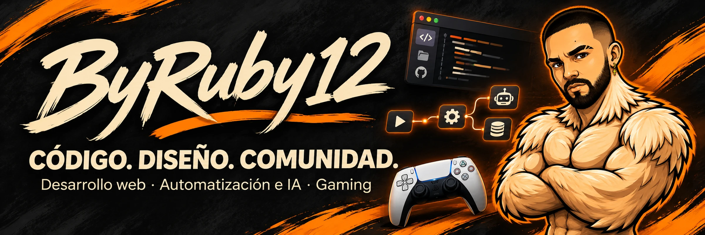
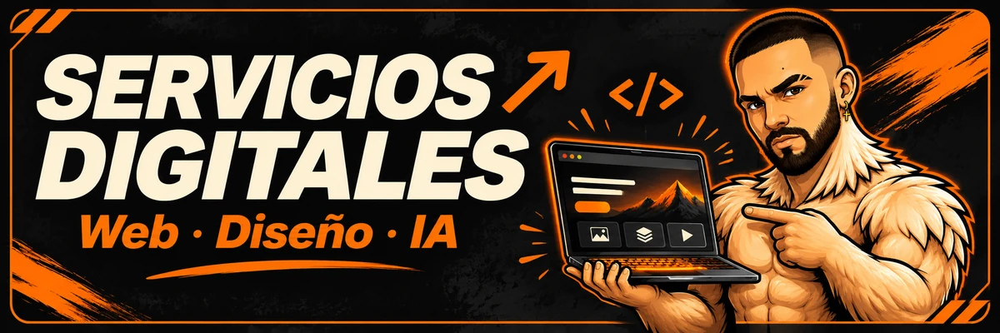
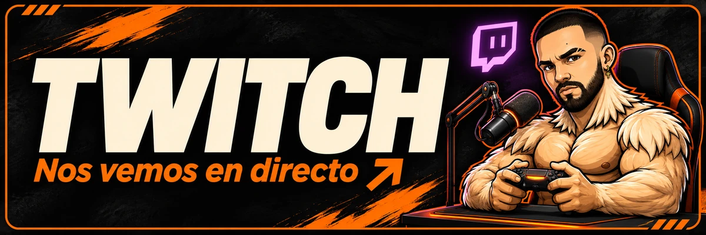
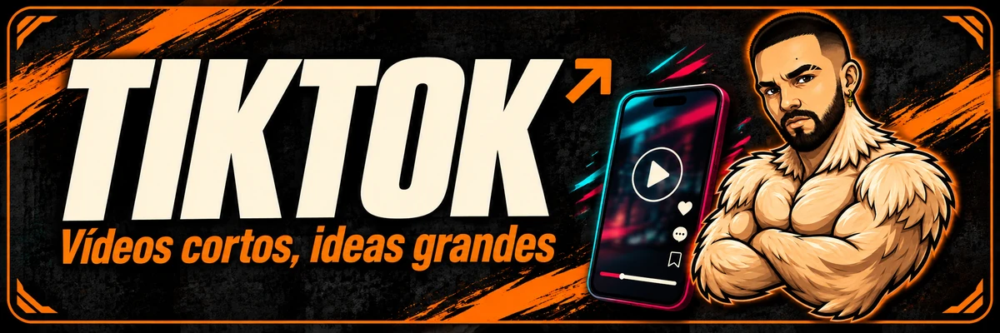
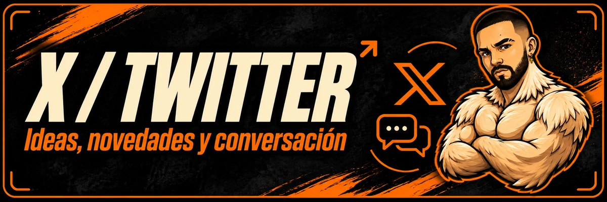
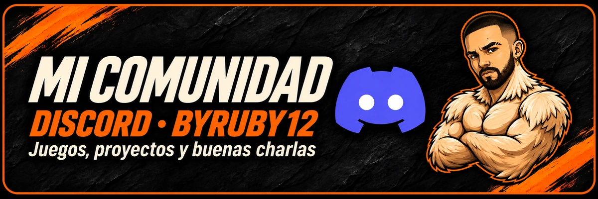
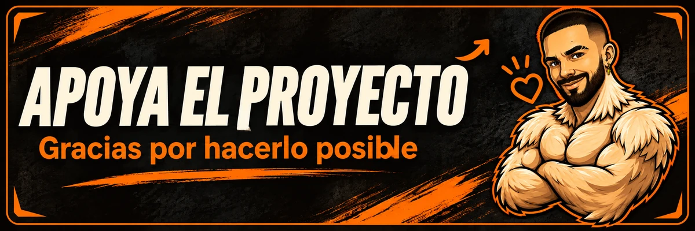

<!-- Perfil contrastado con CV, portfolio, catálogo de servicios y enlaces publicados. -->

<h1>Hola, soy Tomás Cano 👋</h1>
<h3>Desarrollo web · Automatización e IA · Diseño digital</h3>

Construyo webs, herramientas de gestión y automatizaciones. Cuido el código, el diseño y la experiencia de quien las usa.

<strong>📍 Madrid, España &nbsp; / &nbsp; 💻 ByRuby12</strong>

<a href="#proyectos-destacados">Proyectos</a> &nbsp; · &nbsp;
<a href="#experiencia">Experiencia</a> &nbsp; · &nbsp;
<a href="#tecnologias">Tecnologías</a> &nbsp; · &nbsp;
<a href="#servicios-digitales">Servicios</a> &nbsp; · &nbsp;
<a href="#comunidad">Comunidad</a> &nbsp; · &nbsp;
<a href="#contacto">Contacto</a>

<a href="https://github.com/ByRuby12/Portfolio-Tomas/raw/refs/heads/main/docs/CV%20TOMAS%2020262027%20NEW.pdf"><strong>Descargar mi CV ↗</strong></a> &nbsp; · &nbsp; <a href="https://www.linkedin.com/in/canoo18/">LinkedIn ↗</a>

---

## ✦ De una idea a algo que funciona

Soy **Tomás Cano Nieto**, desarrollador web con formación en **Desarrollo de Aplicaciones Web** y **Sistemas Microinformáticos y Redes**. Combino programación, diseño y conocimiento de la operativa de un negocio: desde una interfaz responsive hasta el panel de gestión, los datos y las tareas del día a día.

He trabajado con comercio electrónico, CRM, inventario, ticketing, bots, APIs, automatizaciones y herramientas de Inteligencia Artificial. Me interesa entender el problema, construir una solución clara y cuidar tanto su funcionamiento como su presentación.

Mi otra gran parte es **ByRuby12**: más de nueve años creando contenido, compartiendo videojuegos y desarrollando ideas para una comunidad online.

<table>
<tr>
<td width="50%" align="center"></td>
<td width="50%" align="center"></td>
</tr>
</table>

---

## ⚡ Del problema a la solución

| Si necesitas… | Puedo ayudarte con… |
| :--- | :--- |
| **Lanzar o mejorar tu presencia online** | Webs responsive, tiendas online, cartas QR y paneles de administración. |
| **Ordenar la operativa de tu negocio** | CRM, stock, inventario, ticketing y herramientas de gestión. |
| **Reducir tareas repetitivas** | Bots, automatización de flujos, APIs e integración de IA. |
| **Dar identidad a tu proyecto** | Diseño digital, recursos para creadores, cartelería y edición de imágenes. |

---

## 🚀 Proyectos destacados

Tres proyectos que reúnen mis principales áreas de trabajo: producto web, automatización y comunidad.

### 01 / La Tortillería · Carta digital

**El objetivo:** facilitar la consulta de la carta y la gestión de su contenido.

**Mi trabajo:** desarrollo de una carta responsive con categorías, productos y herramientas de administración, utilizando Firebase para la gestión de datos.

**Enfoque:** experiencia móvil, contenido organizado y gestión del negocio.

[Ver el repositorio de La Tortillería →](https://github.com/ByRuby12/LaTortilleria)

### 02 / AyuntMadrid · Bot de Telegram con IA

**El objetivo:** ayudar a tramitar avisos y peticiones ciudadanas desde un canal conversacional.

**Mi trabajo:** desarrollo y mantenimiento del bot, integración con APIs y uso de IA para procesar y clasificar solicitudes.

**Enfoque:** automatización, tratamiento de información y conexión entre servicios.

[Ver el repositorio de AyuntMadrid →](https://github.com/ByRuby12/AyuntMadrid)

### 03 / LeidersRP · Comunidad y herramientas

**El objetivo:** organizar una comunidad de GTA V Roleplay para PS4 y PS5.

**Mi trabajo:** desarrollo de la plataforma y de herramientas para usuarios, economía, inventarios, trabajos y gestión de la comunidad.

**Enfoque:** sistemas conectados y herramientas adaptadas a las necesidades del roleplay.

[Ver el repositorio de LeidersRP →](https://github.com/ByRuby12/LeidersRP)

**Más trabajo publicado**

| Proyecto | Qué puedes consultar |
| :--- | :--- |
| [Portfolio personal](https://github.com/ByRuby12/Portfolio-Tomas) | Proyectos, trayectoria y acceso al CV. |
| [ByRuby12 · Servicios](https://github.com/ByRuby12/ByRuby12-Servicios) | Catálogo de servicios y ejemplos visuales. |
| [Bohio Bar](https://github.com/ByRuby12/BohioBar) | Carta web para hostelería. |
| [CartaWebVersiones](https://github.com/ByRuby12/CartaWebVersiones) | Versiones y recursos para cartas digitales. |
| [StockageTienda](https://github.com/ByRuby12/StockageTienda) | Gestión de inventario y operaciones de tienda. |

<strong>Ver todos los proyectos y líneas de trabajo del portfolio y el CV</strong>

| Proyecto o línea | Qué he desarrollado | Acceso |
| :--- | :--- | :--- |
| **TPV Hostelería y pedidos QR** | Plataforma para clientes, camareros, cocina y administración; pedidos en tiempo real, caja y pagos mixtos. | [Repositorio](https://github.com/ByRuby12/TPV-Hosteleria) |
| **Carta Web · versión profesional** | Productos, alérgenos, redes, idiomas y diseño mobile-first con datos JSON. | [Versiones](https://github.com/ByRuby12/CartaWebVersiones) |
| **Carta Web · versión básica** | Navegación sencilla por categorías y contenido desde JSON. | [Versiones](https://github.com/ByRuby12/CartaWebVersiones) |
| **Cartas para negocios** | Proyectos aplicados a La Tortillería, Bohio Bar y otros locales de hostelería. | [La Tortillería](https://github.com/ByRuby12/LaTortilleria) · [Bohio Bar](https://github.com/ByRuby12/BohioBar) |
| **LeidersRP · Community hub** | Web de comunidad con normativas, novedades y accesos a sistemas. | [Web](https://github.com/ByRuby12/LeidersRPWeb) |
| **LeidersRP · PDA y sistemas** | Usuarios, perfiles, DNI, economía y consolas para Policía y EMS; gestión de informes, vehículos, sanciones y expedientes. | [Plataforma](https://github.com/ByRuby12/LeidersRP) |
| **Bot multifunción de Discord** | Moderación, usuarios, economía, tickets, automatizaciones y herramientas administrativas. | [Detalle en el CV](https://github.com/ByRuby12/Portfolio-Tomas/raw/refs/heads/main/docs/CV%20TOMAS%2020262027%20NEW.pdf) |
| **Stockage · gestión de tienda** | Organización de inventario, stock y operaciones. | [Repositorio](https://github.com/ByRuby12/StockageTienda) |
| **Bot de Madrid Móvil** | Telegram, APIs REST e IA para avisos y peticiones ciudadanas. | [Repositorio](https://github.com/ByRuby12/AyuntMadrid) |
| **Bibliotech** | Proyecto de biblioteca multimedia con backend, datos e interfaz de consulta. | [Repositorio](https://github.com/ByRuby12/Bibliotech-DAW) |
| **Sportdistrict · TFG DAW** | Plataforma de ligas deportivas de barrio con equipos, partidos, árbitros, estadísticas y administración. Calificación del TFG: **8/10**. | [Repositorio](https://github.com/ByRuby12/TFG-DAW) |
| **CremEsports** | Mi primera web: entorno gaming con secciones, productos y flujo de compra. | [Repositorio](https://github.com/ByRuby12/CremEsports) |
| **Videojuegos Processing** | Minijuegos en Java/Processing, como Tetris, Snake, Pong, PacMan y Flappy Bird. | [Repositorio](https://github.com/ByRuby12/VideoJuegos-Processing) |
| **Videojuegos HTML** | Juegos en navegador: Buscaminas, Tetris, Pacman, Dinosaurio y otros experimentos. | [Repositorio](https://github.com/ByRuby12/Videojuegos-HTML) |
| **El Pollo Loco** | Juego web con minijuegos, retos y navegación temática. | [Repositorio](https://github.com/ByRuby12/PolloLoco) |
| **Proyectos DAW, IoT y ORM** | Prácticas de bibliotecas, acceso a datos, IoT, A-Frame, MVC, Tailwind, trivials y webs dinámicas. | [Repositorio](https://github.com/ByRuby12/DAW) |
| **WebUniversal** | Proyecto web orientado a negocios. | [Repositorio](https://github.com/ByRuby12/WebUniversal) |

También he desarrollado webs corporativas y tiendas online para distintos sectores, además de sistemas de gestión. Algunos trabajos profesionales se describen en el CV y no cuentan con código público.

[Explorar todos mis repositorios →](https://github.com/ByRuby12?tab=repositories)

---

## 🛠️ Tecnologías y herramientas

Tecnologías utilizadas en mi experiencia profesional, proyectos personales y formación. Cada repositorio concreta las herramientas que utiliza.

| Frontend | Backend y datos | Integraciones y diseño |
| :--- | :--- | :--- |
| HTML5 · CSS3 · SCSS · JavaScript | Python · PHP · Java · Node.js | APIs REST · OpenAI API |
| Vue · Tailwind CSS · Bootstrap | NestJS · SQL · MySQL · MariaDB | Telegram · Discord · IA |
| Responsive · UX/UI | SQL Server · Firebase · Firestore | Photoshop · Premiere Pro · CapCut |

<strong>Ver herramientas, competencias y entorno técnico completo</strong>

| Área | Herramientas y experiencia |
| :--- | :--- |
| **Lenguajes y formatos** | HTML5, CSS3, SCSS, JavaScript, Python, PHP, Java, SQL, JSON y XML. |
| **Frameworks y librerías** | Vue.js, NestJS, Node.js, Bootstrap, Tailwind CSS, Python-Telegram-Bot, Axios, Requests, asyncio y nest_asyncio. |
| **Datos** | MySQL, MariaDB, SQL Server, phpMyAdmin, Firebase y Firestore; diseño y administración de bases de datos, consultas SQL y modelos ORM. |
| **IA y automatización** | OpenAI API, integración de APIs de IA, procesamiento de lenguaje natural, prompt engineering, bots inteligentes, asistentes y colaboración con LAIADESK. |
| **Calidad y mantenimiento** | pytest, unittest, logging, pruebas automatizadas, depuración, resolución de incidencias y mantenimiento de código. |
| **Desarrollo y despliegue** | Git, GitHub, Visual Studio Code, PyCharm, Postman, VirtualBox, APIs REST, frontend y backend, hosting, dominios, IONOS, Plesk y correo corporativo. |
| **Web y experiencia de usuario** | Mobile-first, diseño responsive, UX/UI, SEO técnico y optimización del rendimiento. |
| **CRM y negocio** | Aplicaciones CRM, ticketing, gestión documental y comercial, inventario y automatización empresarial. |
| **Diseño y audiovisual** | Adobe Photoshop, Adobe Premiere Pro, CapCut, TikTok Studio, diseño publicitario y edición de vídeo. |
| **Marketing y comercio electrónico** | TikTok Shop, Mailchimp, email marketing, segmentación de contactos, redes sociales, SEO y fichas de producto. |
| **Obtención de datos** | Web scraping y tratamiento de información pública de Google Maps y webs de empresas. |
| **Sistemas y redes** | Windows, redes WiFi, cableado estructurado, reparación y configuración de equipos, hardware, software y soporte técnico. |
| **Logística y producción** | Stock, almacén, preparación de pedidos, paquetería, gestión con GLS y CTT Express y personalización mediante impresión DTF. |
| **Trabajo en equipo** | Coordinación de tareas, gestión de proyectos, organización de personal, resolución de problemas y aprendizaje continuo. |

## 🧩 Experiencia y formación

Mi recorrido combina **desarrollo web, automatización y operativa de negocio**. He trabajado tanto en la construcción de herramientas como en los procesos que esas herramientas tienen que resolver.

<strong>Experiencia profesional · tres etapas</strong>

### La Tienda del Humor · Desarrollador web

**Octubre de 2025 – actualidad**

- Desarrollo y mantenimiento de webs corporativas y tiendas online, con atención al rendimiento, UX y SEO.
- Diseño e implementación de **más de 15 aplicaciones web y sistemas CRM** para sectores como merchandising, alimentación, tecnología, vinos y cervezas, además de plataformas de empleo y reservas.
- Administración de bases de datos; bots y APIs de IA para búsqueda y gestión de productos; colaboración con **LAIADESK** en soluciones, asistentes y flujos automatizados.
- Sistemas de ticketing, scraping de datos públicos, campañas y segmentación con **Mailchimp**.
- Inventario, stock, logística, paquetería y operación de **TikTok Shop** y otros canales de venta.
- Personalización de merchandising mediante **DTF**, diseño con **Photoshop**, edición con **CapCut** y coordinación de tareas y personal.

### Ayuntamiento de Madrid · IAM · Desarrollador web (FCT)

**Marzo – junio de 2025**

- Desarrollo y mantenimiento de un bot de **Telegram para Madrid Móvil**, utilizando Python.
- Integración de **OpenAI** para procesar y clasificar solicitudes; conexión con APIs REST y datos JSON.
- Procesos asíncronos con **asyncio**, gestión de credenciales y variables de entorno, logging y pruebas automatizadas.
- Despliegue y mantenimiento en Windows; respuestas dinámicas, menús interactivos y soporte multilingüe.
- Coordinación técnica y seguimiento de mejoras con el equipo del proyecto.

### La Tienda del Espía · Desarrollador web y soporte informático

**Febrero de 2021 – enero de 2025**

- Desarrollo y actualización de webs corporativas y comercio electrónico.
- Administración y optimización de bases de datos y servidores; gestión de productos con CRM.
- Instalación de redes WiFi, cableado estructurado y cableado de una nueva oficina.
- Reparación y configuración de equipos, soporte a usuarios y resolución de incidencias de hardware y software.
- Códigos de barras, inventario y operaciones logísticas; diseño HTML/CSS y material gráfico con Photoshop.

| Formación | Centro y periodo |
| :--- | :--- |
| **Técnico Superior en Desarrollo de Aplicaciones Web** | IES Villaverde · septiembre de 2022 – junio de 2025 |
| **Técnico de Sistemas Microinformáticos y Redes** | TEIDE HEASE · septiembre de 2020 – junio de 2022 |

**Idiomas:** español nativo · inglés B1.

<strong>Más sobre mi perfil y disponibilidad</strong>

Formación en desarrollo full stack, bases de datos, APIs REST, despliegue, metodologías ágiles, Git, sistemas Windows, redes y seguridad informática.

Disponibilidad completa y posibilidad de incorporación inmediata, según mi CV. Permisos de conducción **B, B1, A1 y AM**.

Contacto profesional: [byruby12.contacto@gmail.com](mailto:byruby12.contacto@gmail.com). Los datos de contacto adicionales se encuentran en el CV.

[Ver mi trayectoria en el portfolio →](https://byruby12.github.io/Portfolio-Tomas/) · [Descargar mi CV completo →](https://github.com/ByRuby12/Portfolio-Tomas/raw/refs/heads/main/docs/CV%20TOMAS%2020262027%20NEW.pdf)

---

## ✳️ Servicios digitales · ByRuby12

Además de mis proyectos, ofrezco servicios para negocios y creadores. En la web puedes consultar ejemplos, condiciones, alcance y precios actualizados.

| Web, datos y negocio | Diseño, identidad y contenido |
| :--- | :--- |
| **Tu tienda online, completa** · e-commerce y administración | **Pack Creador** · tu marca lista para redes |
| **Tu web profesional desde cero** · desarrollo a medida | **Carteles, flyers y cartas** · diseño para tu negocio |
| **Contactos para tu negocio** · bases de datos en Excel | **Retoque y edición de fotos** · mejora de imágenes |
| **Mantenimiento y mejoras web** · cambios y soporte | **Tu marca, a lo grande** · publicidad de gran formato |
| **Universal Works** · presencia digital para negocios | **Tu local, ahora en digital** · web y carta QR |

**[Explorar los diez servicios →](https://byruby12.github.io/ByRuby12-Servicios/)**

## 🧭 Así me gusta trabajar

| 01 · Entender | 02 · Construir | 03 · Mejorar |
| :--- | :--- | :--- |
| Conocer el problema, el material disponible y el alcance. | Diseñar la experiencia y desarrollar sus funciones. | Probar, revisar los detalles y ajustar el resultado. |

---

## 🎮 Código, juegos y comunidad

Llevo más de **nueve años creando contenido**, con vídeos, directos, gameplays y edición para YouTube, Twitch, TikTok y otras redes.

Me gustan **GTA V, Minecraft, The Last of Us, Call of Duty, Payday 2 y Super Mario Galaxy**. También la realidad virtual con **Meta Quest 3** y la conducción con volante. Ese lado creativo está presente en mis vídeos, directos, diseños y proyectos de comunidad.

<table>
<tr>
<td width="50%" align="center"></td>
<td width="50%" align="center"></td>
</tr>
<tr>
<td width="50%" align="center"></td>
<td width="50%" align="center"></td>
</tr>
<tr>
<td width="50%" align="center"></td>
<td width="50%" align="center"></td>
</tr>

</table>

<strong>Más enlaces y apoyo al proyecto</strong>

<table>
<tr>
<td width="50%" align="center"></td>
<td width="50%" align="center"></td>
</tr>
</table>

---

## 🤝 Tu próxima idea empieza aquí

¿Buscas colaboración técnica o quieres dar forma a un proyecto? Me interesa trabajar en **desarrollo web, herramientas de gestión y automatización con IA**.

Cuéntame qué quieres construir, para quién y qué necesitas resolver. Si tienes referencias o una web actual, puedes incluirlas en tu mensaje.

**[byruby12.contacto@gmail.com](mailto:byruby12.contacto@gmail.com)**

[LinkedIn](https://www.linkedin.com/in/canoo18/) · [Portfolio](https://byruby12.github.io/Portfolio-Tomas/) · [Servicios](https://byruby12.github.io/ByRuby12-Servicios/)

ByRuby12 · Código, diseño y comunidad.

<a href="#top">Volver arriba ↑</a>

